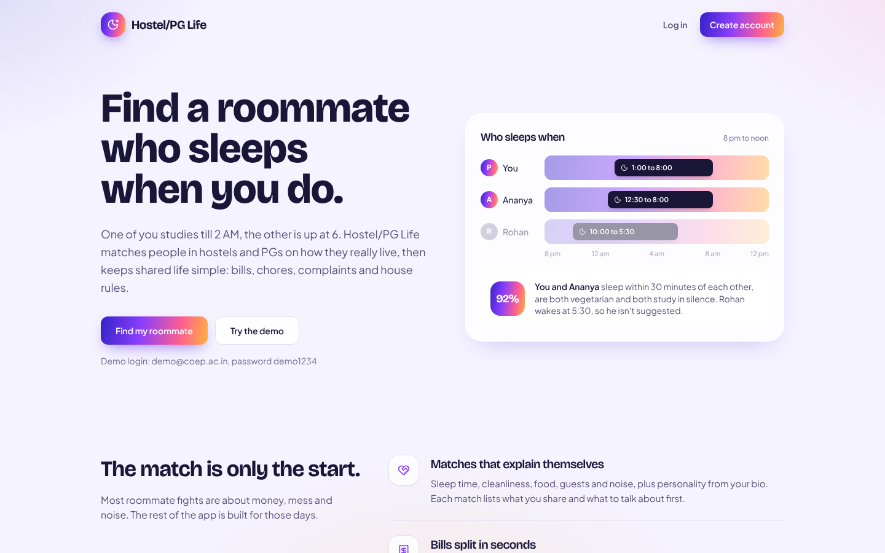
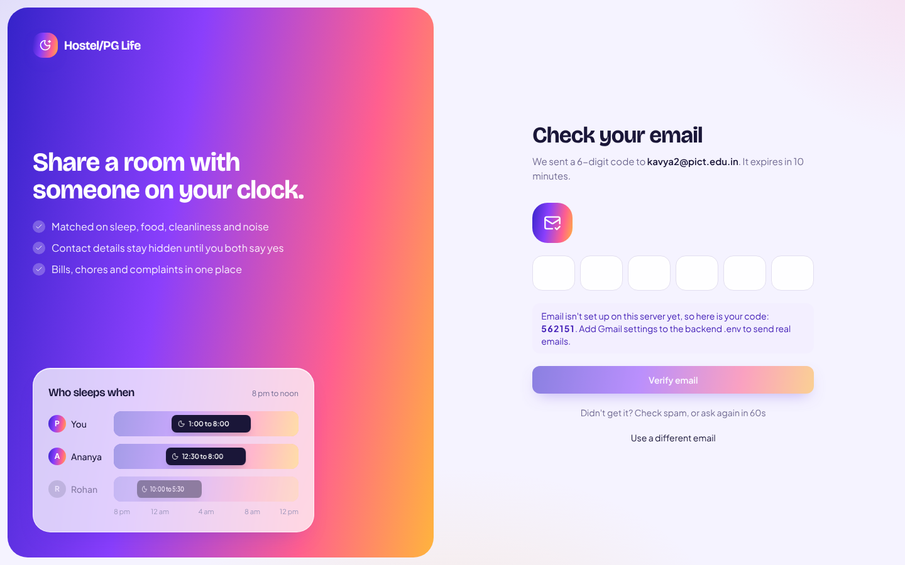
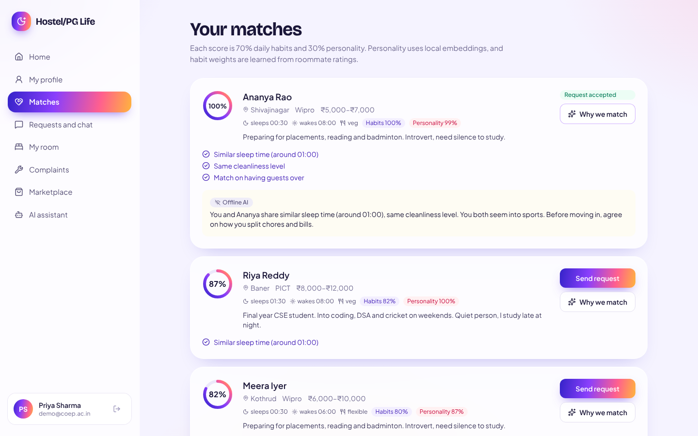
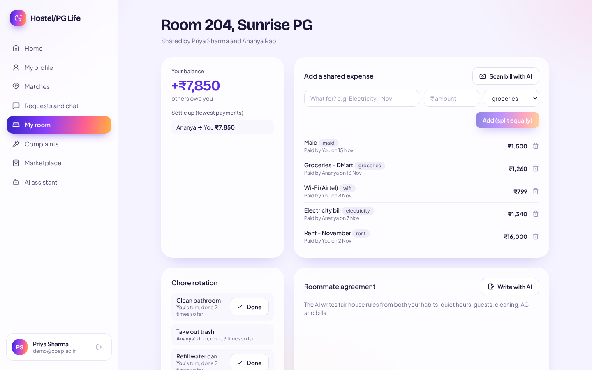
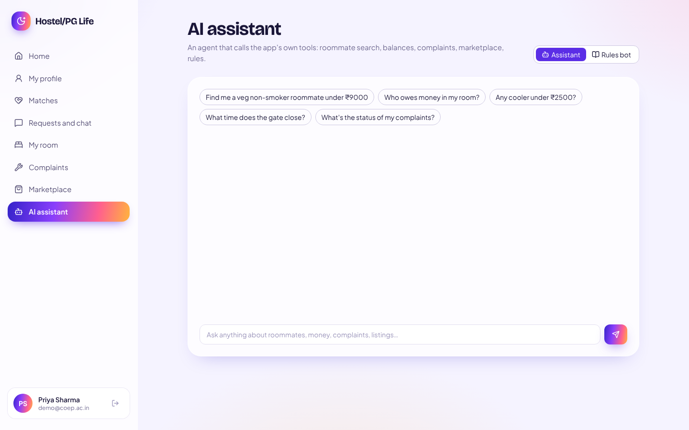
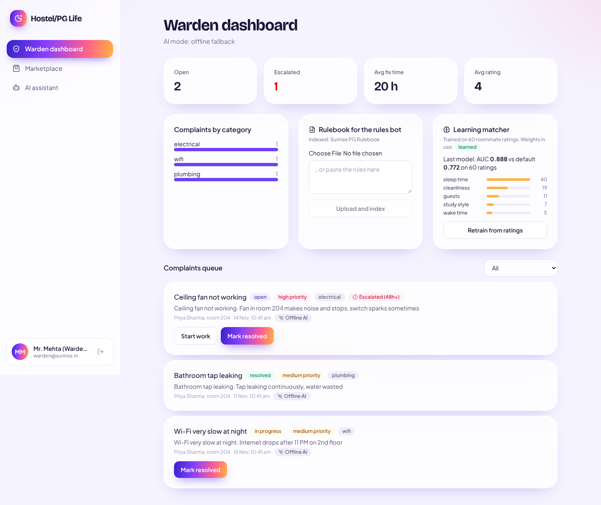
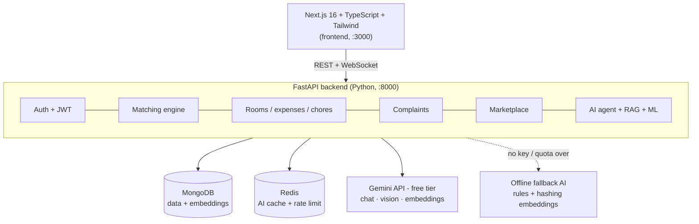

# Hostel/PG Life 🏠
**AI-powered roommate matching and shared-living platform for hostels and PGs in India.**

One studies till 2 AM, the other wakes at 6. One is veg, the other cooks chicken in the room. Roommates are usually random, and that causes daily fights. Hostel/PG Life matches people on how they actually live, then helps them split bills, share chores, get complaints fixed and buy/sell used stuff.

> Runs on the **free Gemini API**, and also works **fully offline** with no API key (built-in fallback AI), so a demo never breaks.

## 📸 Screenshots
| Landing page | Sign-up with email code |
|---|---|
|  |  |
| **Matches with reasons** | **Room: bills, chores, AI agreement** |
|  |  |
| **AI assistant (agent with tools)** | **Warden dashboard + learning matcher** |
|  |  |

---

## ✨ Features

| Module | What it does |
|---|---|
| **Secure accounts** | Sign-up needs a 6-digit email code (10-minute expiry, 5 tries, stored only as a keyed hash). Forgot password by email code. **Continue with Google**. Strong-password rule, bcrypt, JWT. |
| **AI onboarding chat** | A chat builds your profile (sleep time, food, cleanliness, smoking, guests, AC…) instead of a long form. |
| **Hybrid AI matching** | Hard filters (city, gender preference, budget, move-in date, dealbreakers) → habit score (11 weighted factors) + personality score (embeddings of your bio) → final %. Every match shows reasons and conflicts. |
| **"Why we match"** | AI writes a short summary of what you share and what to agree on before moving in. |
| **Requests, privacy, chat** | Contact details unlock only after both accept. Real-time WebSocket chat with scam and abuse detection. Report and block. |
| **Room + expenses** | Split rent, electricity, Wi-Fi equally or custom. **Debt simplification** settles everyone in the fewest payments. |
| **AI bill scanner** | Photo of a bill → amount, title and category filled in by a vision model. |
| **Chores + agreement** | Auto-rotating chores. AI writes a fair roommate agreement from both people's habits. |
| **Smart complaints** | Photo + text → AI sets category and priority. Unresolved after 48 hours → escalated. Warden dashboard with stats. |
| **Marketplace** | Sell your cooler to juniors. AI fills the listing from a photo, suggests a price and flags scams. |
| **Rules bot (RAG)** | Warden uploads the PG rulebook (PDF/text); students ask questions and get answers **with sources**. |
| **AI assistant (agent)** | "Veg non-smoker in Kothrud under ₹9000?" "Who owes me money?" The agent calls the app's own tools (read-only) and answers. |
| **Learning matcher (ML)** | Roommates rate each other after a month; a scikit-learn model learns which habits really predict happy pairs and updates the weights, but only if it beats the defaults (AUC check). |

---

## 🧱 Architecture



| Layer | Tech |
|---|---|
| Frontend | Next.js 16 (App Router), React 19, TypeScript, Tailwind CSS v4, Bricolage Grotesque + Plus Jakarta Sans, lucide icons |
| Backend + AI | Python 3.12, FastAPI, Pydantic v2, PyMongo async, WebSockets |
| AI | Google Gemini (free): `gemini-3.5-flash-lite` for chat/vision/JSON (or `gemini-3.8-flash` for smarter answers), `gemini-embedding-001` for embeddings |
| ML | scikit-learn (logistic regression, cross-validated AUC), NumPy |
| Data | MongoDB 7, Redis 7 |
| DevOps | Docker (multi-stage, non-root, health checks), Docker Compose, GitHub Actions CI |

---

## 🚀 Quick start

### Option A: Docker (recommended)
```bash
cp backend/.env.example backend/.env      # add your free GEMINI_API_KEY (optional)
docker compose up --build
docker compose exec backend python -m scripts.seed   # demo data
```
Open **http://localhost:3000**. API docs (Swagger): **http://localhost:8000/docs**

### Option B: Run without Docker or MongoDB (fastest demo)
```bash
cd backend
pip install -r requirements-dev.txt
python -m scripts.demo_server        # in-memory DB, auto-seeded, port 8000

cd ../frontend
npm install
npm run dev                          # http://localhost:3000
```

### Option C: Manual with your own MongoDB
```bash
cd backend && pip install -r requirements.txt
cp .env.example .env                 # set MONGO_URL and GEMINI_API_KEY
python -m scripts.seed
uvicorn app.main:app --reload

cd frontend && npm install && npm run dev
```

**Demo logins** (password `demo1234`):
- `demo@coep.ac.in`: student with a room, roommate, expenses, chores, complaints
- `warden@sunrise.in`: warden dashboard, rulebook upload, ML training

---

## 🔑 Get the free Gemini API key (2 minutes, no card)
1. Go to **https://aistudio.google.com/apikey** and sign in with Google.
2. Click **Create API key** and copy it.
3. Put it in `backend/.env`: `GEMINI_API_KEY=your_key_here`
4. Restart the backend. The UI badges switch from **Offline AI** to **Gemini AI**.

Notes:
- Free-tier limits change from time to time; the app caches AI answers, rate-limits each user (`AI_DAILY_LIMIT_PER_USER`) and falls back to offline AI if a call fails.
- If Google renames models, change `GEMINI_MODEL` / `GEMINI_EMBED_MODEL` in `.env`. No code change needed.
- Never commit `.env`. It's in `.gitignore`.

---

## ✉️ Turn on real emails (free, with Gmail)
Without this, the 6-digit codes print in the backend terminal and show on screen (dev mode), so you can test right away.
1. Your Google account needs **2-Step Verification** on (myaccount.google.com/security).
2. Go to **https://myaccount.google.com/apppasswords**, create an app password named "Hostel PG Life" and copy the 16 letters.
3. In `backend/.env`:
   ```
   SMTP_USER=yourname@gmail.com
   SMTP_PASSWORD=abcdefghijklmnop
   ```
4. Restart the backend. Codes now arrive by email and no longer show on screen.

Gmail allows about 500 emails a day on a free account, plenty for a college project.

## 🔐 Turn on "Continue with Google" (free, about 10 minutes)
1. Open **https://console.cloud.google.com**, create a project (e.g. "Hostel PG Life").
2. **APIs & Services → OAuth consent screen**: choose *External*, fill in the app name and your email, save.
3. **APIs & Services → Credentials → Create credentials → OAuth client ID**:
   - Application type: **Web application**
   - Authorised JavaScript origins: `http://localhost:3000` (add your deployed URL later)
4. Copy the **Client ID** (ends in `.apps.googleusercontent.com`) into `backend/.env`:
   ```
   GOOGLE_CLIENT_ID=1234567890-abc.apps.googleusercontent.com
   ```
5. Restart the backend. The Google button appears on the login and sign-up pages. (The frontend reads the Client ID from the backend, so there's nothing to change in the frontend.)

While the consent screen is in *Testing* mode, add your own Gmail under **Test users**.

## 🧠 How the AI works (interview notes)

**Matching score**
```
final = 0.7 × habits_score + 0.3 × personality_score
habits_score = Σ weight_i × similarity_i   (weights sum to 100)
```
- Sleep time has the highest default weight (20) because it causes the most fights. Times wrap around midnight (23:30 vs 00:30 = 1 hour apart).
- Dealbreakers are **hard filters**, not score penalties: a smoker never appears for someone who marked smoking as a dealbreaker.
- Personality: bios are embedded (Gemini embeddings, or a local hashing-trick vector offline) and compared with cosine similarity, rescaled per model.
- Every profile stores a local vector always and a Gemini vector when available. Comparisons use Gemini vectors only when both people have one, so mixed data never breaks.

**Learning matcher**: each roommate rating becomes a training row (11 factor scores + personality → happy if ≥ 4 stars). Logistic regression with stratified cross-validation; its AUC is compared with the default weights' AUC, and the new weights go live **only if they're better**. Learned weights are blended 50/50 with defaults so a rarely-complained-about factor never drops to zero. (Seed data: learned AUC ≈ 0.89 vs default ≈ 0.77.)

**AI agent**: the model replies with JSON `{"tool": ..., "args": ...}` or `{"answer": ...}`; the server runs the tool and feeds back the result (max 4 steps). Tools are read-only, so the agent can't change data by mistake. Offline, keyword intent detection picks the tool.

**RAG rules bot**: rulebook → chunks (~600 chars) → embeddings → top-3 by cosine → LLM answers only from those excerpts and cites them. Offline, it returns the best-matching sentences.

**Accounts**: a 6-digit code is generated with `secrets`, stored as an HMAC (never in plain text), expires in 10 minutes, allows 5 tries and can be re-sent once a minute. Forgot-password answers the same whether or not the email exists, so nobody can check who has an account. Google sign-in verifies the ID token with Google (audience and issuer checked) and links to an existing account with the same verified email.

**Safety and privacy**: contact details hidden until both accept; bcrypt passwords; JWT; scam/abuse detection on chat and listings; no phone numbers or emails sent to the LLM; every LLM output validated before saving.

---

## 📁 Project structure
```
hostel-pg-life/
├── backend/
│   ├── app/
│   │   ├── main.py            FastAPI app, CORS, routers
│   │   ├── ai/                llm.py (Gemini client), features.py (AI features), fallback.py (offline AI)
│   │   ├── services/          matching, splitting, learner (ML), rag, agent, limits (Redis)
│   │   └── routers/           auth, profiles, matches, chat, rooms, complaints, market, ai_tools
│   ├── scripts/               seed.py (demo data), demo_server.py (no-Mongo demo)
│   ├── tests/                 24 tests: logic, accounts, full API flow, WebSocket chat, Gemini path
│   └── Dockerfile
├── frontend/
│   ├── src/app/               landing, login, register, (app)/dashboard, profile, matches,
│   │                          requests, chat/[id], room, complaints, market, assistant, warden
│   ├── src/components/        UI kit, auth context, cards
│   └── Dockerfile             multi-stage, standalone output
├── docker-compose.yml         mongo + redis + backend + frontend
└── .github/workflows/ci.yml   tests, lint, build, docker build
```

## 🧪 Tests
```bash
cd backend && pip install -r requirements-dev.txt && pytest -q    # 24 passed
cd frontend && npm run lint && npm run build
```

## ☁️ Free deployment
| Part | Free option |
|---|---|
| Frontend | Vercel (set `NEXT_PUBLIC_API_URL` to your backend URL) |
| Backend | Render or Railway (Docker deploy from `backend/`) |
| Database | MongoDB Atlas free cluster |
| Redis | Upstash free tier (optional) |

Set `CORS_ORIGINS` on the backend to your Vercel URL and a long random `JWT_SECRET`.

## 📝 Resume line
**Hostel/PG Life: AI-powered roommate matching platform** | Next.js, TypeScript, Python, FastAPI, Gemini API, MongoDB, scikit-learn, Docker
- Built a hybrid matching engine (weighted habit scoring + embedding similarity) with explainable match reasons and dealbreaker filters.
- Added an LLM agent with tool calling, vision-based bill scanning and complaint triage, and a RAG bot over hostel rulebooks, with an offline fallback for every AI feature.
- Trained a learning matcher on roommate ratings (AUC 0.89 vs 0.77 baseline); shipped with Docker Compose, CI on GitHub Actions and 24 automated tests.

## 🔭 Future scope
Mobile app (React Native), Hindi voice input for the assistant, PG owner listings with online rent (Razorpay), mess food ratings and waste prediction, shared cab pooling.
